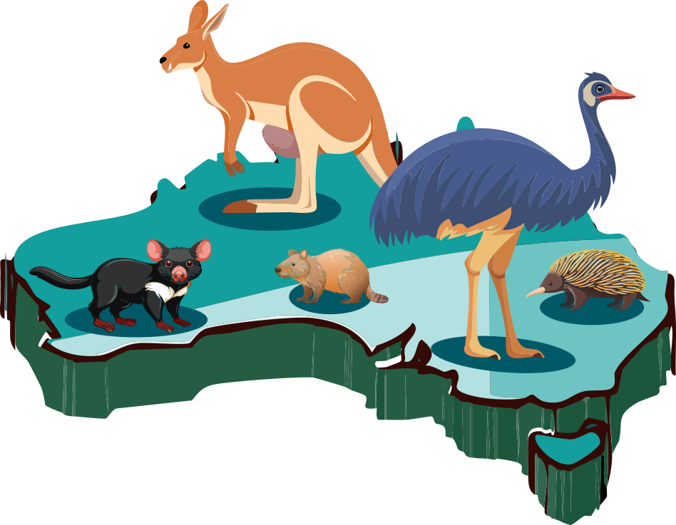

<div style="display: flex; align-items: center;">
  
  
</div>

# WildObsR

<!-- badges: start -->
[](https://github.com/WildObs/WildObsR/actions/workflows/R-CMD-check.yaml)
[](https://app.codecov.io/gh/WildObs/WildObsR)
[](https://opensource.org/licenses/MIT)
<!-- badges: end -->

The Wildlife Observatory of Australia ([WildObs](https://www.wildobs.org.au)) provides a
suite of tools, such as the [WildObs Image Platform](https://www.wildobs.org.au/image-platform)
and [Tagged Image Repository](https://www.wildobs.org.au/tagged-image-repository), to
enhance and support camera trapping across Australia. WildObsR provides programmatic access
to query, download and prepare camera trap data from the
[WildObs Database](https://www.wildobs.org.au/database). Every project arrives as a
[Camera Trap Data Package](https://camtrap-dp.tdwg.org/) (Camtrap DP), meaning each dataset
contains tables of camera deployments, wildlife detections and media (*i.e.*, images and/or
videos), along with Creative Commons licences, formatted citations and field definitions
that travel with them.

- **Discover** what data exist: search projects by place, time, species, sampling design
  or contributor, including embargoed projects, which are listed before their data are
  released.
- **Access** curated data packages, with threatened-species records protected, image
  records, and a citation for every project (`cite_datapackages()`).
- **Interoperate** with other Camtrap DP tools: `as_camtrapdp()` converts to canonical
  Camtrap DP for the camtrapdp and camtrapR packages and for GBIF.
- **Harmonise** projects with different designs: group cameras into cells of any size,
  rebuild long-term deployments, and reclassify independent detections.
- **Add spatial context**: state, IBRA bioregion and CAPAD protected area, with the
  layers shipped in the package.

Full documentation and tutorials: **<https://wildobs.github.io/WildObsR/>**

## Installation

```r
# install.packages("pak")
pak::pak("WildObs/WildObsR")
```

WildObsR needs R 4.1 or later. On Linux, install the GDAL, PROJ, GEOS and OpenSSL
development libraries first (for example
`sudo apt install libgdal-dev libproj-dev libgeos-dev libssl-dev`).

## Quick start

Downloading data needs a free personal API key from the
[WildObs Dashboard](https://dashboard.wildobs.org.au), stored in your `.Renviron` file as
`WILDOBSR_API_KEY`. The [Get started](https://wildobs.github.io/WildObsR/articles/WildObsR.html)
article walks through it.

```r
library(WildObsR)
api_key <- Sys.getenv("WILDOBSR_API_KEY")

# find every project with cameras in a box around the Wet Tropics of Queensland
ids <- wildobs_mongo_query(api_key = api_key,
                           spatial = list(xmin = 144.9, xmax = 146.5,
                                          ymin = -19.6, ymax = -15.3))

# download them as Camtrap DP data packages; embargoed projects arrive as metadata only
dp_list <- wildobs_dp_download(api_key = api_key, project_ids = ids)

# read a table, and cite the data
deployments <- frictionless::read_resource(dp_list[[1]], "deployments")
writeLines(cite_datapackages(dp_list))
```

No key yet? Two open projects, from the Queensland Wet Tropics and New South Wales, ship
with the package:

```r
dp_list <- example_datapackages()
```

## Tutorials

| Article | What it covers |
|---|---|
| [Get started](https://wildobs.github.io/WildObsR/articles/WildObsR.html) | Installing, getting an API key, the first download |
| [Discover what exists](https://wildobs.github.io/WildObsR/articles/discover.html) | Searching the database and reading project metadata |
| [Inside a WildObs data package](https://wildobs.github.io/WildObsR/articles/data-package.html) | Every table and identifier, and how WildObs extends Camtrap DP |
| [For data providers](https://wildobs.github.io/WildObsR/articles/data-providers.html) | Your projects as others see them: embargoes, obscuring, citations |
| [Images for computer vision](https://wildobs.github.io/WildObsR/articles/images.html) | Downloading labelled images |
| [Camtrap DP interoperability](https://wildobs.github.io/WildObsR/articles/interoperability.html) | camtrapdp, GBIF, camtrapR and its survey dashboard |
| [Spatial context](https://wildobs.github.io/WildObsR/articles/spatial-context.html) | States, bioregions, protected areas and camera spacing |
| [Detection histories and sampling effort](https://wildobs.github.io/WildObsR/articles/detection-histories.html) | Effort and detection matrices for occupancy and abundance models |
| [Fit single-season models](https://wildobs.github.io/WildObsR/articles/fitting-models.html) | unmarked, spOccupancy, spAbundance and NIMBLE on one survey |
| [Fit multi-season models](https://wildobs.github.io/WildObsR/articles/long-term.html) | Long-term deployments, colonisation and extinction, and trends |
| [Working with Claude](https://wildobs.github.io/WildObsR/articles/claude-skill.html) | A guide to the data for AI coding assistants |

## Keeping WildObsR up to date

WildObsR checks its own version the first time you query or download data in a session
and warns if a newer release is available; it never blocks your work. Update by running
the install command again. WildObsR uses [semantic versioning](https://semver.org/)
(`major.minor.patch`):

| Change | Example | What it means for you |
|---|---|---|
| **major** | `1.0.0` → `2.0.0` | **Not backwards compatible.** An old installed version will produce broken or wrong downloads. Update before running anything. |
| **minor** | `0.3.0` → `0.4.0` | Backwards-compatible additions, such as new functions, or database changes that old code still handles correctly. Update when convenient. |
| **patch** | `0.4.0` → `0.4.1` | Behaviour-preserving fixes. Nothing you rely on changes. |

## Citation

Please cite the release of WildObsR you used, and every data package you analysed:

```r
citation("WildObsR")
cite_datapackages(dp_list)
```

## Getting help and contributing

- Bugs and tutorial requests: [GitHub issues](https://github.com/WildObs/WildObsR/issues)
- Questions about a project's data: data@wildobs.org.au
- Contributing code: see [CONTRIBUTING](.github/CONTRIBUTING.md)

## License

MIT License; see [LICENSE.md](LICENSE.md). The bundled CAPAD 2022 and IBRA 7 layers are
© Commonwealth of Australia (DCCEEW), licensed under Creative Commons Attribution.

## Acknowledgments

WildObsR development is supported by:

- **Queensland Cyber Infrastructure Foundation (QCIF)**
- **Terrestrial Ecosystem Research Network (TERN)**
- **Australian Research Data Commons (ARDC)**
- **Atlas of Living Australia (ALA)**
- **University of Queensland, School of the Environment**
