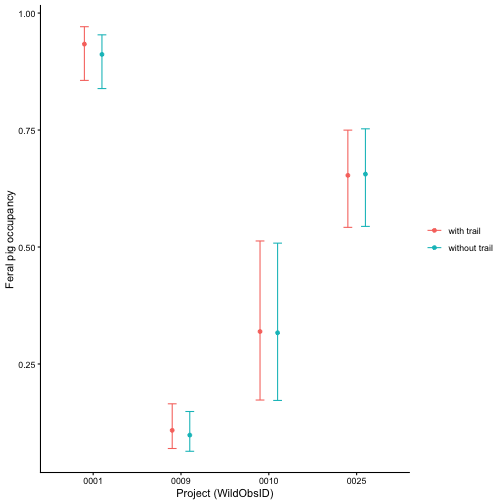

# Combine projects to ask one question

One camera trap project may span one to several landscapes. Combining
projects lets you ask how a species varies across Australia, but
projects also differ in how they placed their cameras, and those
sampling artifacts can look like real differences. This vignette
combines four open projects to ask where feral pigs (*Sus scrofa*)
occur, and how much of the difference between projects comes from where
the cameras were placed. It builds on *Detection histories and sampling
effort* and *Fit single-season models*.

## Download the projects

The four projects span Queensland, New South Wales and Victoria.
[`wildobs_dp_download()`](https://wildobs.github.io/WildObsR/reference/wildobs_dp_download.md)
downloads them by their project IDs, which you can find with
[`wildobs_mongo_query()`](https://wildobs.github.io/WildObsR/reference/wildobs_mongo_query.md)
(see *Discover what exists*):

``` r

# load the R packages
library(WildObsR)   # for data access and wrangling
library(unmarked)   # for running occupancy models

# read your API key from your .Renviron file
api_key <- Sys.getenv("WILDOBSR_API_KEY")
# specify the four projects to combine by ID exactly
ids <- c("ZAmir_QLD_Wet_Tropics_2022_WildObsID_0001",
         "NSW-VIC_Upper_Murray_fire_landscapes_Linley_2021-22_WildObsID_0009",
         "NSW_Woomargama_wombats_Linley_2021-22_WildObsID_0010",
         "NSW_HCCB_Fire_Marshall_2022-2023_WildObsID_0025")
# use the download function to create a list containing one data package per project
dps <- wildobs_dp_download(api_key = api_key, project_ids = ids)
```

## Check that the designs compare

Before combining, check how each project sampled. The metadata hold the
sampling design, and the deployments record whether each camera was
baited and what feature it faced:

``` r

# extract the project-level metadata
proj <- extract_metadata(dps, "project")
# and inspect the sampling designs used
table(proj$samplingDesign)
#> 
#>  clusteredRandom     experimental systematicRandom 
#>                1                1                2

# stack the deployments of all four projects into one table
deps <- do.call(dplyr::bind_rows, lapply(dps, frictionless::read_resource, "deployments"))
# create a simple project label using the WildObsID stored in projectName
deps$project <- substr(sub(".*_WildObsID_", "", deps$projectName), 1, 4)

# were any deployments baited?
table(deps$project, deps$baitUse)
#>       
#>        FALSE
#>   0001   275
#>   0009   581
#>   0010   219
#>   0025   172
# what features were the deployments facing?
table(deps$project, as.character(deps$featureType), useNA = "ifany")
#>       
#>        burrow roadDirt roadPaved roadUnderpass trailGame trailHiking
#>   0001      0       65         9             1         0          63
#>   0009      0        0         0             0         0           0
#>   0010    118        0         0             0         0           0
#>   0025      0        0         0             0       172           0
#>       
#>        waterSource <NA>
#>   0001           1  136
#>   0009           0  581
#>   0010           0  101
#>   0025           0    0
```

No camera was baited, but placement differs a lot. Every camera in 0025
faced a game trail, none in 0009 faced a feature, and 0010 placed just
over half its cameras at wombat burrows. Cameras on roads and trails
often detect more animals, so placement goes into the detection model.
Here a camera counts as on trail when it faced a road or a trail;
burrows and unrecorded features count as off trail:

``` r

# create a binary column on trail when the camera faced a road or trail, otherwise off trail
deps$trailStatus <- ifelse(grepl("^(road|trail)", deps$featureType), "onTrail", "offTrail")
# view the share of each project's deployments on trail
round(prop.table(table(deps$project, deps$trailStatus), 1), 2)
#>       
#>        offTrail onTrail
#>   0001      0.5     0.5
#>   0009      1.0     0.0
#>   0010      1.0     0.0
#>   0025      0.0     1.0
```

## One effort matrix for every station

The observations and covariates stack the same way as the deployments.
Every station (*i.e.*, a `locationID`, which may contain several
`deploymentID`s) from every project then goes into one effort matrix
with the same occasions: 10 days long, over each station’s first 100
days, the length of one single-season survey formatted by WildObs:

``` r

# stack the observations and the covariates of all four projects
obs <- do.call(dplyr::bind_rows, lapply(dps, frictionless::read_resource, "observations"))
covs <- do.call(dplyr::bind_rows, lapply(dps, frictionless::read_resource, "covariates"))

# create the effort matrix, filled with camera-days per locationID and 10-day occasion
# over its first 100 days, split by trail status
eff <- effort_matrix(deps, site_col = "locationID", w = 10, dur = 100, split_by = "trailStatus")
#> effort_matrix(): the deployments span 2 time zones (Australia/Brisbane, Australia/Melbourne), so days run midnight to midnight UTC for all of them.
#> Effort and detections share these day boundaries, so the matrices stay consistent; a day starts at 10 am in AEST, for example. Pass one time_zone to use local days instead.
# create the detection history of feral pigs
y_pig <- detection_matrix(obs = obs, effort = eff, scientificNames = "Sus scrofa", type = "occupancy")
#> detection_matrix(): set aside 1394 obscured observation(s), which carry no camera.
#> Detection histories from public data under-count those species where they are listed.
#> detection_matrix(): set aside 322577 observation(s) that are not of animals (blank, human, vehicle, ...).
#> detection_matrix(): left out 1454 detection(s) after the first 100 days (dur).
```

The projects run on different clocks, so
[`effort_matrix()`](https://wildobs.github.io/WildObsR/reference/effort_matrix.md)
counts days in UTC for every camera, and says so. Because effort and
detections share those days, the matrices still agree.

Each station needs one value of every site covariate. Here they are its
project, and its forest integrity averaged over its deployments:

``` r

# ensure one forest integrity value per locationID, averaged over its deployments
site_covs <- aggregate(FLII_3km2 ~ locationID, data = covs, FUN = mean)
# and the project of each station, as a factor for the model
site_covs$project <- factor(substr(sub(".*_WildObsID_", "", site_covs$locationID), 1, 4))

# format for unmarked, with the covariates matched to stations by name
umf <- model_matrix_input(detections = y_pig, effort = eff, site_covs = site_covs, output = "unmarked")
# calculate the proportion of stations in each project that detected a pig (naive occupancy)
naive <- tapply(apply(getY(umf), 1, max, na.rm = TRUE), siteCovs(umf)$project, mean)
round(naive, 2)
#> 0001 0009 0010 0025 
#> 0.86 0.10 0.32 0.65
```

## Model occupancy with and without the sampling artifacts

Both models let occupancy differ by project and forest integrity, and we
assume detection rises with greater sampling effort. Only the second
model lets detection differ between cameras on and off trails:

``` r

# without the trail term
pig_naive <- occu(~ scale(effort) ~ project + scale(FLII_3km2), umf)
# with the share of camera-days on trail in detection
pig_trail <- occu(~ scale(effort) + trailStatus_onTrail ~ project + scale(FLII_3km2), umf)

# rank them by AIC
modSel(fitList(without_trail = pig_naive, with_trail = pig_trail))
#>               nPars     AIC  delta   AICwt cumltvWt
#> with_trail        8 2650.98   0.00 1.0e+00     1.00
#> without_trail     7 2757.22 106.24 8.5e-24     1.00

# view the better model
pig_trail
#> 
#> Call:
#> occu(formula = ~scale(effort) + trailStatus_onTrail ~ project + 
#>     scale(FLII_3km2), data = umf)
#> 
#> Occupancy (logit-scale):
#>                  Estimate    SE     z  P(>|z|)
#> (Intercept)         2.596 0.433  5.99 2.09e-09
#> project0009        -4.488 0.493 -9.11 8.15e-20
#> project0010        -3.414 0.608 -5.62 1.95e-08
#> project0025        -2.373 0.540 -4.39 1.11e-05
#> scale(FLII_3km2)    0.795 0.164  4.84 1.33e-06
#> 
#> Detection (logit-scale):
#>                     Estimate     SE      z  P(>|z|)
#> (Intercept)           -1.155 0.1137 -10.17 2.83e-24
#> scale(effort)          0.358 0.0473   7.57 3.64e-14
#> trailStatus_onTrail    1.449 0.1481   9.78 1.31e-22
#> 
#> AIC: 2650.981 
#> Number of sites: 444
```

Cameras on trails detected pigs far more often, and AIC strongly prefers
the model that says so. Check its fit before reading the estimates:

``` r

# load a quick function to calculate a chi-squared statistic over each station and occasion where a camera ran
chisq <- function(fm) {
  # the observed detections
  o <- getY(fm@data)
  # the expected detections
  e <- fitted(fm)
  # the sum of squared differences, scaled by their expected variance
  sum((o - e)^2 / (e * (1 - e)), na.rm = TRUE)
} # end chisq function

# set the seed to make the simulations repeatable
set.seed(1)
# compare the real statistic with 100 simulations; occasions with no camera simulate as NA,
# and the warnings about them are expected
suppressWarnings(parboot(pig_trail, statistic = chisq, nsim = 100))
#> 
#> Call: parboot(object = pig_trail, statistic = chisq, nsim = 100)
#> 
#> Parametric Bootstrap Statistics:
#>     t0 mean(t0 - t_B) StdDev(t0 - t_B) Pr(t_B > t0)
#> 1 3308           -660              257         0.99
#> 
#> t_B quantiles:
#>        0% 2.5%  25%  50%  75% 97.5% 100%
#> [1,] 3325 3513 3830 3948 4080  4421 5082
#> 
#> t0 = Original statistic computed from data
#> t_B = Vector of bootstrap samples
```

## Compare the projects

Predict occupancy for each project at its own average forest integrity,
from both models. To begin, build a table of new values to predict from,
grounded in the observed values:

``` r

# each project at its own average forest integrity
nd <- data.frame(project = factor(levels(site_covs$project)),
                 FLII_3km2 = as.numeric(tapply(site_covs$FLII_3km2, site_covs$project, mean)))
# predicted occupancy and its 95% interval from each model
pred <- rbind(cbind(nd, model = "without trail", predict(pig_naive, type = "state", newdata = nd)),
              cbind(nd, model = "with trail", predict(pig_trail, type = "state", newdata = nd)))

# plot occupancy by project, with each model side by side
ggplot2::ggplot(pred, ggplot2::aes(project, Predicted, colour = model)) +
  # the estimate as a point, with the two models apart
  ggplot2::geom_point(position = ggplot2::position_dodge(width = 0.4)) +
  # and its 95% interval
  ggplot2::geom_errorbar(ggplot2::aes(ymin = lower, ymax = upper), width = 0.2,
                         position = ggplot2::position_dodge(width = 0.4)) +
  # label the axes
  ggplot2::labs(x = "Project (WildObsID)", y = "Feral pig occupancy", colour = NULL) +
  # a plain background
  ggplot2::theme_classic()
```



plot of chunk predict

The two models give almost the same occupancy, even though placement
changed detection so much. The per-occasion detection probability,
averaged by project, shows why:

``` r

# detection probability in every station and occasion, from the model with trail
p <- predict(pig_trail, type = "det")$Predicted
# averaged by project, skipping occasions with no camera
round(tapply(p, rep(siteCovs(umf)$project, each = ncol(getY(umf))), mean, na.rm = TRUE), 2)
#> 0001 0009 0010 0025 
#> 0.46 0.21 0.36 0.53
```

A camera on a trail in 0025 detected pigs, where present, in about half
its occasions; one off trail in 0009, in about one in five. Over ten
occasions, even the off-trail cameras were likely to detect pigs at
least once where they occurred, so the differences between projects here
reflect where pigs live rather than where cameras were placed. With
fewer or shorter occasions, or rarer species, the same difference in
detection would bias a naive comparison, and only a model that includes
it would correct for it.

## Cite every project

Combined analyses must cite every data package they use.
[`cite_datapackages()`](https://wildobs.github.io/WildObsR/reference/cite_datapackages.md)
writes the citations:

``` r

# one citation per project, with the date it was accessed
writeLines(cite_datapackages(dps, accessed = Sys.Date()))
#> Zachary Amir, Tom Bruce & Matthew Luskin (2022). WildObs Camera Trap Data Package: Zachary Amir's camera trap surveys from 6 national parks in QLD's Wet Tropics rainforests from late 2022 to early 2023 targeting feral and native vertebrates [Camera Trap Data Package]. WildObs National Wildlife Camera Database. https://wildobs.org.au. RAiD: https://raid.org/10.83062/cb5829ab. WildObs data package version 1.2.0. Accessed 2026-11-10.
#> Grant Linley, Chris Jolly & Emma E Spencer (2021). WildObs Camera Trap Data Package: Wombat burrows are hotspots for small vertebrates in a landscape subject to gigafire [Camera Trap Data Package]. WildObs National Wildlife Camera Database. https://wildobs.org.au. RAiD: https://raid.org/10.83062/9eec588a. WildObs data package version 1.1.0. Accessed 2026-11-10.
#> Grant Linley, Dale Nimmo & Emma E Spencer (2021). WildObs Camera Trap Data Package: Monitoring many landscapes in VIC-NSW border to assess impacts of 2019-20 gigafires on wildlife diel activity [Camera Trap Data Package]. WildObs National Wildlife Camera Database. https://wildobs.org.au. RAiD: https://raid.org/10.83062/ce92b549. WildObs data package version 1.1.0. Accessed 2026-11-10.
#> Kieran Marshall, Benjamin Karlson & Emma E Spencer (2022). WildObs Camera Trap Data Package: NPWS Post Fire Threatened Macropod Census [Camera Trap Data Package]. WildObs National Wildlife Camera Database. https://wildobs.org.au. RAiD: https://raid.org/10.83062/7564477a. WildObs data package version 1.1.0. Accessed 2026-11-10.
```

## Learn more

- *Discover what exists*: find projects by place, time, species or
  design.
- unmarked: [occupancy
  models](https://rbchan.github.io/unmarked/articles/unmarked.html).

Session information

``` r

sessionInfo()
#> R version 4.5.1 (2025-06-13)
#> Platform: aarch64-apple-darwin20
#> Running under: macOS Tahoe 26.5.1
#> 
#> Matrix products: default
#> BLAS:   /Library/Frameworks/R.framework/Versions/4.5-arm64/Resources/lib/libRblas.0.dylib 
#> LAPACK: /Library/Frameworks/R.framework/Versions/4.5-arm64/Resources/lib/libRlapack.dylib;  LAPACK version 3.12.1
#> 
#> locale:
#> [1] C.UTF-8/C.UTF-8/C.UTF-8/C/C.UTF-8/C.UTF-8
#> 
#> time zone: Australia/Brisbane
#> tzcode source: internal
#> 
#> attached base packages:
#> [1] stats     graphics  grDevices utils     datasets  methods   base     
#> 
#> other attached packages:
#> [1] unmarked_1.5.1      WildObsR_0.3.0.9000 here_1.0.1         
#> 
#> loaded via a namespace (and not attached):
#>  [1] tidyselect_1.2.1   farver_2.1.2       dplyr_1.2.1        S7_0.2.0          
#>  [5] fastmap_1.2.0      timechange_0.4.0   lifecycle_1.0.5    sf_1.1-3          
#>  [9] cluster_2.1.8.1    ellipsis_0.3.2     terra_1.9-50       magrittr_2.0.5    
#> [13] compiler_4.5.1     rlang_1.3.0        tools_4.5.1        knitr_1.52        
#> [17] labeling_0.4.3     pkgbuild_1.4.8     classInt_0.4-11    curl_8.0.0        
#> [21] RColorBrewer_1.1-3 plyr_1.8.9         pkgload_1.4.1      KernSmooth_2.23-26
#> [25] withr_3.0.3        purrr_1.2.2        desc_1.4.3         grid_4.5.1        
#> [29] e1071_1.7-17       ggplot2_4.0.3      scales_1.4.0       MASS_7.3-65       
#> [33] cli_3.6.6          lutz_0.3.2         vegan_2.7-6        chron_2.3-63      
#> [37] reformulas_0.4.1   generics_0.1.4     remotes_2.5.0      otel_0.2.0        
#> [41] stringdist_0.9.17  rstudioapi_0.17.1  httr_1.4.9         tzdb_0.5.0        
#> [45] sessioninfo_1.2.3  DBI_1.3.0          pbapply_1.7-2      cachem_1.1.0      
#> [49] proxy_0.4-29       stringr_1.6.0      splines_4.5.1      parallel_4.5.1    
#> [53] frictionless_1.3.0 vctrs_0.7.3        devtools_2.4.6     Matrix_1.7-3      
#> [57] jsonlite_2.0.0     mongolite_4.1.0    geojsonsf_2.0.5    hms_1.1.4         
#> [61] oz_1.0-22          tidyr_1.3.2        units_1.0-1        ozmaps_0.4.5      
#> [65] glue_1.8.1         codetools_0.2-20   lubridate_1.9.5    stringi_1.8.9     
#> [69] gtable_0.3.6       tibble_3.3.1       pillar_1.11.1      R6_2.6.1          
#> [73] Rdpack_2.6.4       rprojroot_2.1.1    evaluate_1.0.5     lattice_0.22-7    
#> [77] readr_2.2.0        rbibutils_2.3      memoise_2.0.1      class_7.3-23      
#> [81] Rcpp_1.1.2         nlme_3.1-168       permute_0.9-10     mgcv_1.9-3        
#> [85] xfun_0.61          fs_1.6.6           usethis_3.2.1      pkgconfig_2.0.3
```
