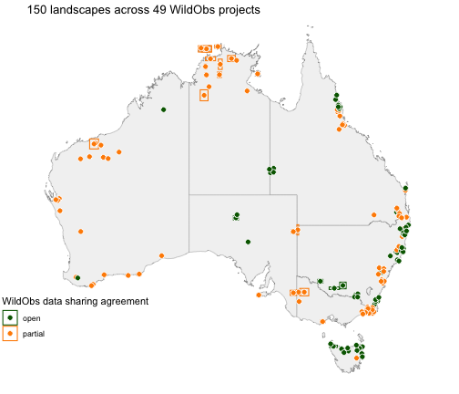

<!-- GENERATED by vignettes/precompute.R: do not edit. Edit discover.Rmd.orig instead, then knit again. -->

Before you download any camera data, it helps to know what the database holds: which
projects sampled your region of interest, when, with what samplingdesign, which species
were recorded, and whether their data remain under embargo or are released yet. All of
that lives in each project's metadata, which is small and quick to access. This vignette
searches the WildObs Database, reads the metadata of what it finds, shows where the same
records are published in other standards (*e.g.*, ALA and TERN), and ends with the each
data package's citations to include in a reference list when using the data. This vignette
does not download any tables from any data packages.


``` r
# load the WildObs R library
library(WildObsR)

# your personal API key, read from .Renviron (see the Get started vignette)
api_key <- Sys.getenv("WILDOBSR_API_KEY")
```

## Search by place, time, species, design or person

`wildobs_mongo_query()` returns the IDs of projects that match every filter you give it.
A filter left out does not restrict the search, but at least one filter is needed:

| Filter | What it matches | Example |
|---|---|---|
| `spatial` | projects with cameras deployed inside a bounding box, in latitude and longitude decimal degrees | `list(xmin = 145, xmax = 154, ymin = -29, ymax = -10)` |
| `temporal` | projects collecting data at any time in a date range | `list(minDate = as.Date("2022-01-01"), maxDate = as.Date("2022-12-31"))` |
| `taxonomic` | projects that recorded any particular species | `c("Phascolarctos cinereus", "Felis catus")` |
| `samplingDesign` | the sampling desing, matching [enumerated Camtrap DP values](https://camtrap-dp.tdwg.org/metadata/#project.samplingDesign) | `"targeted"`, `"systematicRandom"`, `"opportunistic"`, ... |
| `contributors` | projects that include a person's name, email or ORCID, in any role | `"Zachary Amir"` |

A box over the whole continent lists every project a key can see:


``` r
# a box over Australia and its islands
australia <- list(xmin = 110, xmax = 160, ymin = -45, ymax = -9)

# query the database to return every public project ID
all_ids <- wildobs_mongo_query(api_key = api_key, spatial = australia)
# how many projects?
length(all_ids)
#> [1] 49

# run the same query, but only for open projects whose tables can be downloaded today
open_ids <- wildobs_mongo_query(api_key = api_key, spatial = australia,
                                tabularSharingPreference = "open")
# how many projects?
length(open_ids)
#> [1] 20
```

The difference is the **partial** projects. Their metadata are made public, but their
data tables are withheld because of an embargo placed by a data provider. Data providers
can extend or release an embargo, so a project can move between open and partial from one
database release to the next, and the counts above will change. Partial projects are worth
knowing about: a partial project in your study region is a dataset you could request from
its contributors or plan to use once its embargo has expired.

Filters combine as an intersection. For example, the projects that recorded feral cats in
2022 with a targeted design:


``` r
# feral cats, surveyed in 2022, by a targeted design
cat_ids <- wildobs_mongo_query(
  api_key = api_key,
  temporal = list(minDate = as.Date("2022-01-01"), maxDate = as.Date("2022-12-31")),
  taxonomic = "Felis catus",
  samplingDesign = "targeted"
)
# which project IDs were returned?
cat_ids
#> [1] "NSW_Greater_Blue_Mountains_fire_Leigh_2021-2022_WildObsID_0044" 
#> [2] "NSW_Murrumbidgee_Rakali_Sanders_2021-2023_WildObsID_0014"       
#> [3] "NSW_NthCoast_BTRWallaby_Blackmore_2020-2022_WildObsID_0019"     
#> [4] "NSW_NthCoast_PotParma_Blackmore_2021-2022_WildObsID_0017"       
#> [5] "WA_Eurardy_Mammals_Hall_2021-2023_WildObsID_0026"               
#> [6] "WA_Hamelin_Mammals_Hall_2021-2023_WildObsID_0023"               
#> [7] "WA_UpperWarren_predator_monitoring_Harrison_2022_WildObsID_0024"
```

## Download metadata only

You can use the function `wildobs_dp_download()` to download both metadata and data tables
for all WildObs datasets. To access metadata only, set the parameter `metadata_only = TRUE`
to download each project's descriptor without its tables, which takes seconds even for every
 project in the database. Partial projects always download this way.


``` r
# access the descriptors of every visible project
meta <- wildobs_dp_download(api_key = api_key, project_ids = all_ids, metadata_only = TRUE)
#> metadata_only = TRUE -> skipping data resource downloads for speed.
```

## Read the metadata as tables

`extract_metadata()` turns one element of the metadata, across all packages, into a table
with a `DPID` column naming the project. You may also ask for several elements at once to
get a named list of tables.


``` r
# Inspect sampling design and data-sharing preference, one row per project
project <- extract_metadata(meta, "project")
sharing <- extract_metadata(meta, "WildObsMetadata")

# how the projects were designed
table(project$samplingDesign)
#> 
#>  clusteredRandom     experimental    opportunistic     simpleRandom 
#>                8                9                1                6 
#> systematicRandom         targeted 
#>               13               12

# and how they share their data
table(sharing$tabularSharingPreference)
#> 
#>    open partial 
#>      20      29
```

The temporal metadata hold one row per single-season survey (a `deploymentGroup`), so
they show how long each project has been running:


``` r
# start and end of every survey in every project
temporal <- extract_metadata(meta, "temporal")

# Calculate the time span of each project, in years
span <- tapply(seq_len(nrow(temporal)), temporal$DPID, function(i) {
  # from the first survey's start to the last survey's end
  as.numeric(difftime(max(as.Date(temporal$end[i])), min(as.Date(temporal$start[i])),
                      units = "days")) / 365.25
}) # end per project
summary(span)
#>     Min.  1st Qu.   Median     Mean  3rd Qu.     Max. 
#>  0.06845  0.49281  1.29500  1.80089  2.10267 12.42163
```

The spatial metadata returns a bounding box, formatted as `geoJSON`, for each
landscape (a `locationName`) a project sampled. Plotted together they show
where WildObs's data providers have deployed cameras:


``` r
# load ggplot to render nice maps
library(ggplot2)
#> Warning: package 'ggplot2' was built under R version 4.5.2

# extract one bounding box per locationName per project
spatial <- extract_metadata(meta, "spatial")
# add the centroid of each box, since many landscapes are too small to see as boxes across the country
spatial$x <- (spatial$xmin + spatial$xmax) / 2
spatial$y <- (spatial$ymin + spatial$ymax) / 2
# add each landscape's data-sharing preference, from its project
spatial <- merge(spatial, sharing[, c("DPID", "tabularSharingPreference")], by = "DPID")

# grab an outline of Australia's states, as an sf object
aus <- sf::st_as_sf(ozmaps::ozmap_states)

# initialise a ggplot
ggplot() +
  # Add the outline with states in pale grey
  geom_sf(data = aus, fill = "grey95", colour = "grey60") +
  # add the larger landscapes as boxes
  geom_rect(data = spatial, aes(xmin = xmin, xmax = xmax, ymin = ymin, ymax = ymax,
                                colour = tabularSharingPreference), fill = NA) +
  # add a point at the centre of every landscape
  geom_point(data = spatial, aes(x = x, y = y, fill = tabularSharingPreference),
             shape = 21, colour = "white", size = 2.5) +
  # specify two colours for open vs partial, consistent for boxes and points
  scale_fill_manual(values = c(open = "darkgreen", partial = "darkorange"),
                    aesthetics = c("colour", "fill"), name = "WildObs data sharing agreement") +
  # crop to the mainland and Tasmania
  coord_sf(xlim = c(113, 154), ylim = c(-44, -10)) +
  # count the landscapes and projects in the title
  labs(title = sprintf("%d landscapes across %d WildObs projects",
                       nrow(spatial), length(unique(spatial$DPID)))) +
  # no axes or grid, with the legend inside the empty ocean to the west
  theme_void() +
  theme(legend.position = "inside", legend.position.inside = c(0.12, 0.2))
```

<div class="figure">

<p class="caption">plot of chunk map</p>
</div>

## Which species were recorded

The taxonomic metadata list every taxon each project detected, with its rank (e.g.,
species, genus, family, etc.) and English name, so you can search projects for a
specific species before downloading anything.


``` r
# every taxon each project recorded
taxa <- extract_metadata(meta, "taxonomic")

# create a vector of taxa ranked to species-level, and by their two-part scientific name
species <- taxa[taxa$taxonRank == "species" & grepl("^[A-Z][a-z]+ [a-z-]+$", taxa$scientificName), ]
# the number of projects that recorded each species, most widespread first
head(sort(table(species$scientificName), decreasing = TRUE), 10)
#> 
#>             Felis catus  Tachyglossus aculeatus             Canis dingo 
#>                      47                      40                      37 
#>           Vulpes vulpes Colluricincla harmonica   Trichosurus vulpecula 
#>                      35                      29                      28 
#>   Oryctolagus cuniculus        Wallabia bicolor      Gymnorhina tibicen 
#>                      27                      27                      26 
#>              Sus scrofa 
#>                      26
```

## Find the publications associated with a project

Papers, datasets, reports, and workflows linked to a project are listed in its
`relatedIdentifiers`, using persistent identifiers like a DOI or a URL. WildObs
adds one more type, the project's [RAiD](https://raid.org), a persistent
identifier for the research activity itself.


``` r
# links from each project to papers, datasets and its RAiD
related <- extract_metadata(meta, "relatedIdentifiers")
# display the type of identifier and how it is related to the project
table(related$relatedIdentifierType, related$relationType)
#>       
#>        IsCitedBy IsDerivedFrom IsPartOf IsPublishedIn IsSourceOf IsSupplementTo
#>   DOI          1             1        0            18          7              8
#>   RAiD         0             0       49             0          0              0
#>   URL          0             0        2             0          0              0
```

## Find the contributors associated with a project

Each project lists the people affiliated with it, with their role, organisation and
[ORCID](https://orcid.org). For a partial project, they are who to ask about access before
its embargo ends. `extract_metadata()` returns them as a table with one row per person per
project:


``` r
# everyone associated with each project, one row per person per project
collab <- extract_metadata(meta, "contributors")
# the roles people hold across all projects
table(collab$role)
#> 
#>               contact           contributor principalInvestigator 
#>                     5                    80                    49 
#>             publisher          rightsHolder 
#>                     2                     7

# Inspect partial projects, and how many months their tables are embargoed for
partial <- sharing[sharing$tabularSharingPreference == "partial",
                   c("DPID", "embargoPeriodMonths")]

# add the principal investigators of the partial projects to create a new table
partial_pi <- merge(partial, collab[collab$role == "principalInvestigator", ], by = "DPID")
# inspect their names, organisations and embargo lengths
head(partial_pi[, c("DPID", "title", "organization", "embargoPeriodMonths")], 5)
#>                                                             DPID
#> 1 NSW_Greater_Blue_Mountains_fire_Leigh_2021-2022_WildObsID_0044
#> 2  NSW_KangarooValley_AllFauna_CORRIGAN_2024-2025_WildObsID_0035
#> 3     NSW_NthCoast_BTRWallaby_Blackmore_2020-2022_WildObsID_0019
#> 4       NSW_NthCoast_PotParma_Blackmore_2021-2022_WildObsID_0017
#> 5        NSW_PostFire_LFPotoroo_Bentley_2021-2022_WildObsID_0015
#>                   title                            organization
#> 1        Kellie A Leigh                    Science for Wildlife
#> 2         Rhys Corrigan NSW Biodiversity and Conservation Trust
#> 3 Caroline J. Blackmore            NSW Environment and Heritage
#> 4 Caroline J. Blackmore            NSW Environment and Heritage
#> 5          Joss Bentley            NSW Environment and Heritage
#>   embargoPeriodMonths
#> 1                  13
#> 2                  48
#> 3                  19
#> 4                  48
#> 5                  48
```

The `email` column holds each contributor's address, and the `path` column their ORCID.
Write to the principal investigator, or to the person with the `contact` role where a
project names one. For a project with no address listed, write to
[data@wildobs.org.au](mailto:data@wildobs.org.au).

## Find WildObs data in other portals

WildObs also publishes animal detections of open projects to two national portals, so
that people who work in other standards can use them without this package:

| Portal | Standard | What it holds | Find it with |
|---|---|---|---|
| [Atlas of Living Australia](https://collections.ala.org.au/public/show/dr31594) (ALA) | Darwin Core occurrences, passed on to [GBIF](https://www.gbif.org) | one record per animal observation | the [`galah`](https://galah.ala.org.au/R/) package |
| [TERN EcoPlots](https://portal.tern.org.au/metadata/ed3bf2bc-4e31-4cb0-adb6-56fd4bfe3736) | the [TERN ontology](https://linkeddata.tern.org.au) for plot data | one record per animal observation, grouped by landscape | the EcoPlots API, or the Python library [`terndata.ecoplots`](https://github.com/ternaustralia/terndata.ecoplots) |

The records are the same in both portals and in the WildObs Database. Each portal
structures the data differently. The ALA occurrence records tell you where and when
a species was recorded, but not how hard anyone looked. The EcoPlots portal includes
structured survey effort that links the camera trap data to other structured
ecological monitoring efforts, such as Ecological Monitoring System Australia
([EMSA](https://emsa.tern.org.au/)). Clear sampling effort is necessary for
occupancy and abundance models, and is easily derived from data downloaded from WildObs.

The checks below compare each portal with the two projects bundled with WildObsR, which
`example_datapackages()` loads without a download.


``` r
# use the bundled copies of two open projects
bundled <- example_datapackages()

# Grab the observations table for each, subsetted to only animal records
animals <- lapply(bundled, function(dp) {
  # every observation in the package
  obs <- frictionless::read_resource(dp, "observations")
  # keep only the records of animals, which are what the portals receive
  obs[obs$observationType == "animal", ]
}) # end per project
```

### Atlas of Living Australia

In the ALA, WildObs is a data provider, "Wildlife Observatory of Australia", and each
WildObs project is a dataset, which the ALA calls a data resource. Searching the
providers finds WildObs, and counting its records by data resource lists every project
it has published:


``` r
# load ALA's r library for accessing data
library(galah)

# set configurations to query the Atlas of Living Australia (rather than global)
galah_config(atlas = "Australia", verbose = FALSE)

# WildObs as a data provider, with its ALA identifier
search_all(providers, "Wildlife Observatory of Australia")
#> # A tibble: 1 × 3
#>   id     name                              uri                                  
#>   <chr>  <chr>                             <chr>                                
#> 1 dp5214 Wildlife Observatory of Australia https://collections.ala.org.au/ws/da…

# count the number of records in each WildObs dataset in the ALA
ala_datasets <- galah_call() |>
  # only records that WildObs provided
  galah_filter(dataProviderUid == "dp5214") |>
  # one row per dataset, by its ALA identifier
  galah_group_by(dataResourceUid) |>
  # count records rather than download them
  atlas_counts()
# display the results below
ala_datasets
#> # A tibble: 3 × 2
#>   dataResourceUid count
#>   <chr>           <int>
#> 1 dr33011         42931
#> 2 dr31594         33522
#> 3 dr33008         17077
```

Each dataset's description in the ALA's collections registry gives its title, and
stores the WildObs project ID as its `guid`, which links the two:


``` r
# For each project, read the ALA's description as JSON
registry <- lapply(ala_datasets$dataResourceUid, function(dr) {
  jsonlite::fromJSON(paste0("https://collections.ala.org.au/ws/dataResource/", dr))
}) # end per dataset

# the WildObs project ID each dataset was published from
ala_datasets$WildObsID <- vapply(registry, function(reg) reg$guid, character(1))
# and its DOI at GBIF
ala_datasets$doi <- vapply(registry, function(reg) reg$doi, character(1))
# view what was returned as a data frame
as.data.frame(ala_datasets)
#>   dataResourceUid count
#> 1         dr33011 42931
#> 2         dr31594 33522
#> 3         dr33008 17077
#>                                                            WildObsID
#> 1 NSW-VIC_Upper_Murray_fire_landscapes_Linley_2021-22_WildObsID_0009
#> 2                          ZAmir_QLD_Wet_Tropics_2022_WildObsID_0001
#> 3               NSW_Woomargama_wombats_Linley_2021-22_WildObsID_0010
#>               doi
#> 1 10.15468/z2w339
#> 2 10.15468/kjqw3f
#> 3 10.15468/4ca4ed
```

The Woomargama project is in the ALA as one of these datasets. Its records per species
match the bundled copy exactly:


``` r
# the ALA identifier of the Woomargama project
woomargama <- "NSW_Woomargama_wombats_Linley_2021-22_WildObsID_0010"
dr_uid <- ala_datasets$dataResourceUid[ala_datasets$WildObsID == woomargama]

# records per species in the ALA, counted without a download
ala_species <- galah_call() |>
  # only the Woomargama dataset
  galah_filter(dataResourceUid == dr_uid) |>
  # one row per scientific name
  galah_group_by(scientificName) |>
  atlas_counts()

# records per species in the bundled WildObs package
wildobs_species <- as.data.frame(table(scientificName = animals[[woomargama]]$scientificName),
                                 responseName = "wildobs")

# merge both sources side by side
both <- merge(ala_species, wildobs_species, by = "scientificName", all = TRUE)
# inspect detections by most recorded first
head(both[order(-both$count), ], 8)
#>              scientificName count wildobs
#> 86         Wallabia bicolor  4109    4109
#> 84         Vombatus ursinus  3808    3808
#> 41 Notamacropus rufogriseus  2545    2545
#> 78    Trichosurus vulpecula  1770    1770
#> 34       Macropus giganteus  1207    1207
#> 67            Rattus rattus  1101    1101
#> 42    Oryctolagus cuniculus   432     432
#> 29       Gymnorhina tibicen   203     203

# species where the two disagree
sum(both$count != both$wildobs, na.rm = TRUE)
#> [1] 0
```

Counts require no ALA account, but downloading the records themselves does: the ALA asks
for an email address registered with it. With one stored in `.Renviron` as `ALA_EMAIL`, the
records of a dataset come down as one table:


``` r
# the email address registered with the ALA, read from .Renviron
galah_config(email = Sys.getenv("ALA_EMAIL"))

# every occurrence record in the Woomargama dataset
occs <- galah_call() |>
  # only the relevant dataset
  galah_filter(dataResourceUid == dr_uid) |>
  # download the occurrences
  atlas_occurrences()
# how many occurrences were returned?
nrow(occs)
#> [1] 17077
```

The ALA passes the records on to GBIF, which gave each WildObs dataset the DOI listed above.

### TERN EcoPlots

[EcoPlots](https://ecoplots.tern.org.au) is TERN's portal for plot-based ecological
data, where WildObs is one of the datasets. Its API is open: searching it needs no
account or key. Every search is a POST request whose body holds a `query`, and the
`discovery` endpoints list the values a query can use.


``` r
# specify the EcoPlots API
ecoplots <- "https://ecoplots.tern.org.au/api/v1.0"

# helper function to list the values of one search field, optionally within an existing query
ecoplots_discover <- function(field, query = setNames(list(), character(0))) {
  # the query as a JSON body, keeping an empty query as {}
  body <- jsonlite::toJSON(list(query = query), auto_unbox = TRUE)
  # send it to the discovery endpoint for this field
  res <- httr::POST(paste0(ecoplots, "/discovery/", field), body = body,
                    httr::content_type_json())
  # stop if the request failed
  httr::stop_for_status(res)
  # read the answer as a table of names (key) and identifiers (uri)
  jsonlite::fromJSON(httr::content(res, "text", encoding = "UTF-8"))
} # end ecoplots_discover

# every dataset in EcoPlots
datasets <- ecoplots_discover("dataset")
datasets
#>                                        key
#> 1              TERN Ecosystem Surveillance
#> 2                                    QBEIS
#> 3                      Three Parks Savanna
#> 4 Williams Wet Tropics Vertebrate database
#> 5                 TERN Ecosystem Processes
#> 6                     TERN AusPlots Forest
#> 7                                  WildObs
#> 8                                 NSW FMIP
#>                                                          uri
#> 1                 http://linked.data.gov.au/dataset/ausplots
#> 2                   http://linked.data.gov.au/dataset/corveg
#> 3      http://linked.data.gov.au/dataset/three-parks-savanna
#> 4   http://linked.data.gov.au/dataset/wet-tropics-vertebrate
#> 5 http://linked.data.gov.au/dataset/tern-ecosystem-processes
#> 6          http://linked.data.gov.au/dataset/ausplots-forest
#> 7                  http://linked.data.gov.au/dataset/wildobs
#> 8                 http://linked.data.gov.au/dataset/nsw-fmip

# grab the identifier of the WildObs dataset
wildobs_uri <- datasets$uri[datasets$key == "WildObs"]
```

In EcoPlots, a site is one landscape (a WildObs `locationName`), and its name ends with
the WildObs project ID. Listing the sites therefore shows which projects are published:


``` r
# the WildObs query: everything from the WildObs dataset
wildobs_query <- list(dataset = list(wildobs_uri))

# gather every WildObs site in EcoPlots
sites <- ecoplots_discover("site_id", wildobs_query)
# inspect what was returned
sites$key
#> [1] "Wooroonooran_NP-wildobsid_0001"                    
#> [2] "Wooroonooran_Goldfield_Track-wildobsid_0001"       
#> [3] "Danbulla_NP-wildobsid_0001"                        
#> [4] "Eacham_Curtain_Fig_NPs-wildobsid_0001"             
#> [5] "Daintree_NP-wildobsid_0001"                        
#> [6] "Mount_Lewis_NP-wildobsid_0001"                     
#> [7] "obscured_ZAmir_QLD_Wet_Tropics_2022-wildobsid_0001"

# the type of record they hold, which a data request must name
feature <- ecoplots_discover("feature_type", wildobs_query)
# inspect what was returned
feature$key
#> [1] "animal occurrence"
```

The `data` endpoint returns the records that match a query, here as CSV. One landscape
from the Wet Tropics project:


``` r
# specify the Daintree landscape of the Wet Tropics project, and its animal records
daintree_query <- c(wildobs_query, list(
  site_id = list(sites$uri[sites$key == "Daintree_NP-wildobsid_0001"]),
  feature_type = list(feature$uri)
))

# Format a httr request to return records as CSV
res <- httr::POST(paste0(ecoplots, "/data/stream"), query = list(dformat = "csv"),
                  body = jsonlite::toJSON(list(query = daintree_query), auto_unbox = TRUE),
                  httr::content_type_json(), httr::add_headers(Accept = "text/event-stream"),
                  httr::timeout(120))
httr::stop_for_status(res)
# read the CSV into a table
tern <- utils::read.csv(text = httr::content(res, "text", encoding = "UTF-8"))

# one row per animal record
nrow(tern)
#> [1] 2479
# inspect some key values
head(tern[, c("siteName", "scientificName", "animalCount_number", "animalCountResultTime")])
#>                     siteName       scientificName animalCount_number
#> 1 Daintree_NP-wildobsid_0001     Alectura lathami                  1
#> 2 Daintree_NP-wildobsid_0001 Megapodius reinwardt                  2
#> 3 Daintree_NP-wildobsid_0001 Megapodius reinwardt                  1
#> 4 Daintree_NP-wildobsid_0001       Melloria quoyi                  1
#> 5 Daintree_NP-wildobsid_0001              Muridae                  1
#> 6 Daintree_NP-wildobsid_0001              Muridae                  1
#>   animalCountResultTime
#> 1   2022-10-29T00:00:00
#> 2   2022-09-26T00:00:00
#> 3   2022-10-28T00:00:00
#> 4   2022-11-29T00:00:00
#> 5   2022-09-21T00:00:00
#> 6   2022-09-24T00:00:00
```

The same landscape in the bundled package holds the same records:


``` r
# the Wet Tropics project, and the cameras in its Daintree landscape
wet_tropics <- "ZAmir_QLD_Wet_Tropics_2022_WildObsID_0001"
# extract the deployments data table and subset to the Daintree landscape
deps <- frictionless::read_resource(bundled[[wet_tropics]], "deployments")
daintree_deps <- deps$deploymentID[deps$locationName == "Daintree_NP"]

# grab all animal records from the Daintree cameras
daintree <- animals[[wet_tropics]][animals[[wet_tropics]]$deploymentID %in% daintree_deps, ]

# compare the number of records in each source
c(ecoplots = nrow(tern), wildobs = nrow(daintree))
#> ecoplots  wildobs 
#>     2479     2479
# repate for the number of animals counted
c(ecoplots = sum(tern$animalCount_number), wildobs = sum(daintree$count))
#> ecoplots  wildobs 
#>     3023     3023
```

EcoPlots places every record at the landscape's single coordinate and gives its date
without a time, so it suits questions about where and when species occur rather than
camera-level analyses. TERN's [guide to the EcoPlots API in
R](https://ternaus.atlassian.net/wiki/spaces/TERNSup/pages/3042344973/How+to+Access+Data+from+an+API+using+R+-+EcoPlots)
describes more of the query fields.

## Cite what you use

Each project carries the citation that ensures fair recognition to each contributors
associated with a particular dataset. `cite_datapackages()` returns it, with the version
of the data package stored in the database when it was accessed. The citations
can be returned as text, as BibTeX for a reference manager, or as a table:


``` r
# the two open projects bundled with WildObsR, as an example
examples <- c("ZAmir_QLD_Wet_Tropics_2022_WildObsID_0001",
              "NSW_Woomargama_wombats_Linley_2021-22_WildObsID_0010")

# display formatted references, with the date the data were accessed
writeLines(cite_datapackages(meta[examples], accessed = Sys.Date()))
#> Zachary Amir, Tom Bruce & Matthew Luskin (2022). WildObs Camera Trap Data Package: Zachary Amir's camera trap surveys from 6 national parks in QLD's Wet Tropics rainforests from late 2022 to early 2023 targeting feral and native vertebrates [Camera Trap Data Package]. WildObs National Wildlife Camera Database. https://wildobs.org.au. RAiD: https://raid.org/10.83062/cb5829ab. WildObs data package version 1.2.0. Accessed 2026-11-10.
#> Grant Linley, Chris Jolly & Emma E Spencer (2021). WildObs Camera Trap Data Package: Wombat burrows are hotspots for small vertebrates in a landscape subject to gigafire [Camera Trap Data Package]. WildObs National Wildlife Camera Database. https://wildobs.org.au. RAiD: https://raid.org/10.83062/9eec588a. WildObs data package version 1.1.0. Accessed 2026-11-10.

# or BibTeX
utils::toBibtex(cite_datapackages(meta[examples], format = "bibtex"))
#> @Misc{ZAmir_QLD_Wet_Tropics_2022_WildObsID_0001,
#>   title = {Zachary Amir's camera trap surveys from 6 national parks in QLD's Wet Tropics rainforests from late 2022 to early 2023 targeting feral and native vertebrates},
#>   author = {Zachary Amir and Tom Bruce and Matthew Luskin},
#>   year = {2022},
#>   note = {Version 1.2.0. Licence: CC-BY-4.0},
#>   url = {https://raid.org/10.83062/cb5829ab},
#> }
#> 
#> @Misc{NSW_Woomargama_wombats_Linley_2021-22_WildObsID_0010,
#>   title = {Wombat burrows are hotspots for small vertebrates in a landscape subject to gigafire},
#>   author = {Grant Linley and Chris Jolly and Emma E Spencer},
#>   year = {2021},
#>   note = {Version 1.1.0. Licence: CC-BY-4.0},
#>   url = {https://raid.org/10.83062/9eec588a},
#> }
```

Packages downloaded with their tables can also cite the products behind each WildObs
covariate, with `covariates = TRUE`. Each product's citation is named by the covariates it
is behind, without their spatial scale, so `FLII` covers `FLII_point` to `FLII_10km2`:


``` r
# select the bundled Wet Tropics package, which holds its covariates table
wt <- example_datapackages()[["ZAmir_QLD_Wet_Tropics_2022_WildObsID_0001"]]

# the package's citation, then one per covariate product
refs <- cite_datapackages(wt, covariates = TRUE)

# the Forest Landscape Integrity Index, behind the FLII_ columns
refs[["FLII"]]
#> [1] "Grantham, H.S., Duncan, A., Evans, T.D., Jones, K.R., Beyer, H.L., Schuster, R. et al. (2020). Anthropogenic modification of forests means only 40% of remaining forests have high ecosystem integrity. Nature Communications, 11, 5978."

# a product behind several covariates names them all, so search the names
refs[grepl("mean_monthly_temperature", names(refs))]
#>                                                             mean_monthly_precipitation; mean_monthly_temperature 
#> "Hutchinson, M., Xu, T., Kesteven, J., Marang, I., & Evans, B. (2021). ANUClimate 2.0 [Dataset]. NCI Australia."
```

<details>
<summary>Session information</summary>


``` r
sessionInfo()
#> R version 4.5.1 (2025-06-13)
#> Platform: aarch64-apple-darwin20
#> Running under: macOS Tahoe 26.5.1
#> 
#> Matrix products: default
#> BLAS:   /Library/Frameworks/R.framework/Versions/4.5-arm64/Resources/lib/libRblas.0.dylib 
#> LAPACK: /Library/Frameworks/R.framework/Versions/4.5-arm64/Resources/lib/libRlapack.dylib;  LAPACK version 3.12.1
#> 
#> locale:
#> [1] C.UTF-8/C.UTF-8/C.UTF-8/C/C.UTF-8/C.UTF-8
#> 
#> time zone: Australia/Brisbane
#> tzcode source: internal
#> 
#> attached base packages:
#> [1] stats     graphics  grDevices utils     datasets  methods   base     
#> 
#> other attached packages:
#> [1] galah_2.2.0         ggplot2_4.0.3       WildObsR_0.3.0.9000
#> [4] here_1.0.1         
#> 
#> loaded via a namespace (and not attached):
#>  [1] tidyselect_1.2.1   dplyr_1.2.1        farver_2.1.2       S7_0.2.0          
#>  [5] fastmap_1.2.0      timechange_0.4.0   lifecycle_1.0.5    sf_1.1-3          
#>  [9] cluster_2.1.8.1    ellipsis_0.3.2     terra_1.9-50       magrittr_2.0.5    
#> [13] compiler_4.5.1     rlang_1.3.0        tools_4.5.1        utf8_1.2.6        
#> [17] yaml_2.3.12        lobstr_1.1.2       knitr_1.52         bit_4.6.0         
#> [21] pkgbuild_1.4.8     classInt_0.4-11    curl_8.0.0         xml2_1.3.8        
#> [25] plyr_1.8.9         RColorBrewer_1.1-3 pkgload_1.4.1      KernSmooth_2.23-26
#> [29] withr_3.0.3        purrr_1.2.2        desc_1.4.3         grid_4.5.1        
#> [33] e1071_1.7-17       scales_1.4.0       MASS_7.3-65        cli_3.6.6         
#> [37] crayon_1.5.3       lutz_0.3.2         vegan_2.7-6        chron_2.3-63      
#> [41] generics_0.1.4     remotes_2.5.0      otel_0.2.0         stringdist_0.9.17 
#> [45] rstudioapi_0.17.1  httr_1.4.9         tzdb_0.5.0         sessioninfo_1.2.3 
#> [49] DBI_1.3.0          cachem_1.1.0       proxy_0.4-29       stringr_1.6.0     
#> [53] splines_4.5.1      parallel_4.5.1     frictionless_1.3.0 vctrs_0.7.3       
#> [57] devtools_2.4.6     Matrix_1.7-3       jsonlite_2.0.0     mongolite_4.1.0   
#> [61] geojsonsf_2.0.5    potions_0.2.0      hms_1.1.4          bit64_4.8.6       
#> [65] rrapply_1.2.7      oz_1.0-22          tidyr_1.3.2        units_1.0-1       
#> [69] ozmaps_0.4.5       glue_1.8.1         codetools_0.2-20   lubridate_1.9.5   
#> [73] stringi_1.8.9      gtable_0.3.6       tibble_3.3.1       pillar_1.11.1     
#> [77] rappdirs_0.3.4     httr2_1.2.2        R6_2.6.1           rprojroot_2.1.1   
#> [81] vroom_1.7.1        evaluate_1.0.5     lattice_0.22-7     readr_2.2.0       
#> [85] memoise_2.0.1      class_7.3-23       Rcpp_1.1.2         nlme_3.1-168      
#> [89] permute_0.9-10     mgcv_1.9-3         xfun_0.61          fs_1.6.6          
#> [93] usethis_3.2.1      pkgconfig_2.0.3
```

</details>
