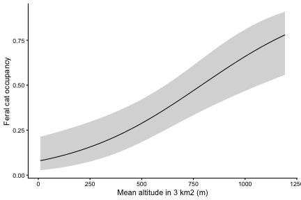

<!-- GENERATED by vignettes/precompute.R: do not edit. Edit fitting-models.Rmd.orig instead, then knit again. -->

This vignette fits single-season occupancy and abundance models to WildObs data with four
R packages. It starts where *Detection histories and sampling effort* ends, with project
0001 resampled to 3 km² hexagonal cells, so everything runs offline on the data shipped
with WildObsR.

| Model | Package | `model_matrix_input(output = )` |
|---|---|---|
| Occupancy, abundance and community occupancy, by maximum likelihood | [unmarked](https://rbchan.github.io/unmarked/) | `"unmarked"` |
| Bayesian occupancy, with or without space | [spOccupancy](https://doserlab.com/files/spoccupancy-web/) | `"spOccupancy"` |
| Bayesian N-mixture abundance | [spAbundance](https://doserlab.com/files/spabundance-web/) | `"spAbundance"` |
| Any model you write yourself | [NIMBLE](https://r-nimble.org/), JAGS or Stan | `"array"` |

The models here are deliberately small, and the Bayesian chains are short so the page builds
in minutes. Before publishing, follow each package's guidance on covariates, priors and
chain length, linked at the end.

## Build the inputs

Every model below shares one effort matrix and one table of site covariates. Effort comes
from the deployments, split by trail status, and the covariates are averaged over the
cameras in each cell:


``` r
# load the R package
library(WildObsR)

# grab the Wet Tropics survey shipped with WildObsR
dp <- example_datapackages("ZAmir_QLD_Wet_Tropics_2022_WildObsID_0001")[[1]]
# extract the three tables, read with their schema types
deps <- frictionless::read_resource(dp, "deployments")
covs <- frictionless::read_resource(dp, "covariates")
obs <- frictionless::read_resource(dp, "observations")
# merge deployments and their environmental covariates as one table
deps <- merge(deps, covs, by = intersect(names(deps), names(covs)))

# create a two-level trail status: any road or trail, or none
deps$trailStatus <- ifelse(is.na(deps$featureType), "offTrail", "onTrail")
# assign every deployment to a 3 km2 hexagonal cell
deps <- spatial_hexagon_generator(deps, scales = 3e6)

# camera-days per cell and 7-day occasion over each cell's first 70 days, split by trail status
eff <- effort_matrix(deps, site_col = "cellID_3km2", w = 7, dur = 70,
                     split_by = "trailStatus", time_zone = dp$temporal$timeZone)

# average the covariates over each cell's cameras, weighting each by its camera-days
cell <- resample_covariates_and_observations(deps, mode_cols_covs = "trailStatus")
#> resample_covariates_and_observations(): featureType (e.g. "roadDirt - roadPaved - trailHiking") kept as text, because some cells hold more than one value.
#> For one value per cell, add the column to mode_cols_covs; to model detection by it, use effort_matrix(split_by = ...).
cell_covs <- cell$spatially_resampled_covariates$cellID_3km2
```

Site covariates need one value per cell. Here they are forest integrity and altitude in the
3 km² around each cell, and the landscape the cell sits in, coded as a whole number because
spOccupancy and spAbundance read random effects only from numbers:


``` r
# keep the cell ID and the covariates the models use
site_covs <- cell_covs[, c("cellID_3km2", "Avg_FLII_3km2", "Avg_altitude_3km2", "locationName")]
# code each landscape as a number, for random effects
site_covs$landscape <- as.integer(factor(site_covs$locationName))
# view how many cells each landscape holds
table(site_covs$locationName)
#> 
#>                  Daintree_NP                  Danbulla_NP 
#>                           23                           13 
#>       Eacham_Curtain_Fig_NPs               Mount_Lewis_NP 
#>                            8                           14 
#> Wooroonooran_Goldfield_Track              Wooroonooran_NP 
#>                           19                           19
# and drop the names, since the models read only numbers
site_covs$locationName <- NULL
```

Spatial models need coordinates in metres. Project the cells' average positions onto the
Australian Albers projection (EPSG:3577), which covers the whole continent:


``` r
# turn each cell's average longitude and latitude into points, in decimal degrees
pts <- sf::st_as_sf(cell_covs, coords = c("Avg_longitude", "Avg_latitude"), crs = 4326)
# project them to metres
xy <- sf::st_coordinates(sf::st_transform(pts, 3577))
# keep the cell ID beside its X and Y, so cells are matched by name
coords <- data.frame(cellID_3km2 = cell_covs$cellID_3km2, X = xy[, "X"], Y = xy[, "Y"])
```

**Site or observation covariates?** A site covariate has one value per cell and goes in the
occupancy or abundance part of a model. It can also go in the detection part, as
`total_effort` does. An observation covariate has one value per cell and occasion, and can
go only in the detection part. `model_matrix_input()` always adds the observation covariates
`effort` (camera-days) and `trailStatus_onTrail` (the share of those camera-days on a trail),
and the site covariate `total_effort`. Covariates you build yourself, such as rainfall per
occasion, go in its `obs_covs` argument as site x occasion matrices.

## Occupancy in unmarked

The feral cat (*Felis catus*) was detected in about a third of the cells, which leaves
occupancy something to explain:


``` r
# create the detection history of feral cats in each cell and occasion
y_cat <- detection_matrix(obs, eff, "Felis catus")
#> detection_matrix(): set aside 452 obscured observation(s), which carry no camera.
#> Detection histories from public data under-count those species where they are listed.
#> detection_matrix(): left out 19 detection(s) after the first 70 days (dur).
# format it for unmarked, with covariates matched to cells by name
umf <- model_matrix_input(y_cat, eff, site_covs = site_covs, output = "unmarked")

# view the site covariates and the observation covariates in the frame
names(unmarked::siteCovs(umf))
#> [1] "Avg_FLII_3km2"     "Avg_altitude_3km2" "landscape"        
#> [4] "total_effort"
names(unmarked::obsCovs(umf))
#> [1] "effort"               "trailStatus_offTrail" "trailStatus_onTrail"
```

unmarked formulas have two sides, `~ detection ~ occupancy`. Scaling continuous covariates
with `scale()` helps the optimiser. The first three models compare the two measures of
effort: `total_effort`, one value per cell, and `effort`, which changes with each occasion:


``` r
# load the unmarked package
library(unmarked)

# fit four models, from no covariates to covariates on both parts
fits <- fitList(
  # constant detection and occupancy
  null = occu(~ 1 ~ 1, umf),
  # detection rises with the cell's total camera-days
  total_effort = occu(~ scale(total_effort) ~ 1, umf),
  # detection rises with the camera-days in each occasion
  effort = occu(~ scale(effort) ~ 1, umf),
  # add trail cameras to detection, and forest integrity and altitude to occupancy
  full = occu(~ scale(effort) + trailStatus_onTrail ~
                scale(Avg_FLII_3km2) + scale(Avg_altitude_3km2), umf)
)
# rank them by AIC
modSel(fits)
#>              nPars    AIC delta   AICwt cumltvWt
#> full             6 471.32  0.00 1.0e+00     1.00
#> effort           3 491.69 20.37 3.8e-05     1.00
#> null             2 492.19 20.88 2.9e-05     1.00
#> total_effort     3 493.75 22.43 1.3e-05     1.00
```

The landscapes differ in ways the covariates may not capture. A random intercept for each
landscape, in lme4 syntax, lets occupancy vary among them:


``` r
# the full model, with a random intercept for each landscape
cat_occ <- occu(~ scale(effort) + trailStatus_onTrail ~
                  scale(Avg_FLII_3km2) + scale(Avg_altitude_3km2) + (1 | landscape), umf)
cat_occ
#> 
#> Call:
#> occu(formula = ~scale(effort) + trailStatus_onTrail ~ scale(Avg_FLII_3km2) + 
#>     scale(Avg_altitude_3km2) + (1 | landscape), data = umf)
#> 
#> Occupancy (logit-scale):
#> Random effects:
#>     Groups        Name Variance Std.Dev.
#>  landscape (Intercept)    1.973    1.405
#> 
#> Fixed effects:
#>                          Estimate    SE     z P(>|z|)
#> (Intercept)                -1.516 0.773 -1.96  0.0498
#> scale(Avg_FLII_3km2)       -0.629 0.502 -1.26  0.2095
#> scale(Avg_altitude_3km2)    1.657 0.650  2.55  0.0108
#> 
#> Detection (logit-scale):
#>                     Estimate    SE      z P(>|z|)
#> (Intercept)           -1.249 0.431 -2.902 0.00371
#> scale(effort)          0.176 0.105  1.671 0.09464
#> trailStatus_onTrail    0.520 0.705  0.737 0.46084
#> 
#> AIC: 458.5018 
#> Number of sites: 96
```

Check the fit before reading the estimates. `parboot()` simulates new data from the model and
compares a fit statistic with the one from the real data. A value of `Pr(t_B > t0)` below
0.05 suggests the model fits poorly:


``` r
# a chi-squared statistic over every cell and occasion with a detection history
chisq <- function(fm) {
  # the observed detections
  o <- getY(fm@data)
  # the expected detections
  e <- fitted(fm)
  # the sum of squared differences, scaled by their expected variance
  sum((o - e)^2 / (e * (1 - e)), na.rm = TRUE)
} # end chisq function

# make the simulations repeatable
set.seed(1)
# compare the real statistic with 100 simulations from the full model; occasions with no
# camera simulate as NA, and the warnings that says are expected
suppressWarnings(parboot(fits@fits$full, statistic = chisq, nsim = 100))
#> 
#> Call: parboot(object = fits@fits$full, statistic = chisq, nsim = 100)
#> 
#> Parametric Bootstrap Statistics:
#>    t0 mean(t0 - t_B) StdDev(t0 - t_B) Pr(t_B > t0)
#> 1 731           -191              129         0.95
#> 
#> t_B quantiles:
#>       0% 2.5% 25% 50% 75% 97.5% 100%
#> [1,] 598  655 857 910 974  1237 1430
#> 
#> t0 = Original statistic computed from data
#> t_B = Vector of bootstrap samples
```

Here 0.95 shows no lack of fit by this statistic, which looks at each occasion separately.
The check by cell in spOccupancy, below, is stricter and finds a problem this one misses.

`predict()` returns occupancy on the probability scale. Here it is across the altitudes of the
surveyed cells, holding forest integrity at its average:


``` r
# a range of altitudes, with forest integrity at its average
nd <- data.frame(
  Avg_altitude_3km2 = seq(min(site_covs$Avg_altitude_3km2), max(site_covs$Avg_altitude_3km2),
                          length.out = 50),
  Avg_FLII_3km2 = mean(site_covs$Avg_FLII_3km2)
)
# predict occupancy and its 95% interval from the model without the random effect
pred <- cbind(nd, predict(fits@fits$full, type = "state", newdata = nd))

# plot occupancy against altitude
ggplot2::ggplot(pred, ggplot2::aes(Avg_altitude_3km2, Predicted)) +
  # the 95% interval as a ribbon
  ggplot2::geom_ribbon(ggplot2::aes(ymin = lower, ymax = upper), fill = "grey85") +
  # and the estimate as a line
  ggplot2::geom_line() +
  # label the axes
  ggplot2::labs(x = "Mean altitude in 3 km2 (m)", y = "Feral cat occupancy") +
  # a plain background
  ggplot2::theme_classic()
```



## Abundance in unmarked

N-mixture models estimate abundance from repeated counts, so first check that the project
recorded group sizes. The metadata say so in `WildObsMetadata$groupSizes`, which is quicker
than downloading the observations (use `wildobs_dp_download(metadata_only = TRUE)`):


``` r
# did this project count the animals in each observation?
dp$WildObsMetadata$groupSizes
#> [1] TRUE
```

Feral pigs (*Sus scrofa*) often travel in groups. `individuals = "max"` takes the largest
group seen in each occasion. It is the conservative choice: `"sum"` gives more variation
between occasions, but can count the same animals twice, which violates the model's
assumptions:


``` r
# create the count history: the most pigs seen together in each cell and occasion
n_pig <- detection_matrix(obs, eff, "Sus scrofa", type = "abundance", individuals = "max")
#> detection_matrix(): set aside 452 obscured observation(s), which carry no camera.
#> Detection histories from public data under-count those species where they are listed.
#> detection_matrix(): left out 158 detection(s) after the first 70 days (dur).
# format it for unmarked
umf_n <- model_matrix_input(n_pig, eff, site_covs = site_covs, output = "unmarked")
```

`pcount()` sums over every possible abundance up to `K`, which must be high enough not to
change the estimates. Fit the Poisson and the negative binomial (`"NB"`), which allows more
variation in abundance among cells:


``` r
# the same covariates as the cat model, with Poisson and negative binomial abundance
pig <- fitList(
  P = pcount(~ scale(effort) + trailStatus_onTrail ~
               scale(Avg_FLII_3km2) + scale(Avg_altitude_3km2), umf_n, K = 60, mixture = "P"),
  NB = pcount(~ scale(effort) + trailStatus_onTrail ~
                scale(Avg_FLII_3km2) + scale(Avg_altitude_3km2), umf_n, K = 60, mixture = "NB")
)
# rank them by AIC
modSel(pig)
#>    nPars     AIC  delta   AICwt cumltvWt
#> NB     7 2084.00   0.00 1.0e+00     1.00
#> P      6 2189.54 105.54 1.2e-23     1.00
```

The negative binomial fits far better. Now check `K`:


``` r
# refit the negative binomial model with a larger K
pig_k <- update(pig@fits$NB, K = 200)
# compare the coefficients at K = 60 and K = 200
round(cbind(K60 = coef(pig@fits$NB), K200 = coef(pig_k)), 2)
#>                                 K60  K200
#> lam(Int)                       2.15  3.11
#> lam(scale(Avg_FLII_3km2))      0.27  0.28
#> lam(scale(Avg_altitude_3km2)) -0.27 -0.29
#> p(Int)                        -2.42 -3.43
#> p(scale(effort))               0.30  0.35
#> p(trailStatus_onTrail)         0.32  0.29
#> alpha(alpha)                   0.34  0.20
```

The covariate effects hardly move, but the abundance and detection intercepts keep drifting
apart as `K` grows. The data cannot separate how many pigs there are from how likely each
one is to be seen, a known weakness of N-mixture models when counts vary a lot. With
unmarked animals on cameras, read these models as relative abundance: the direction and
size of covariate effects, not the number of pigs. The same thing happens in spAbundance
below.

## Community occupancy in unmarked

`occuComm()` fits every species at once. Each species has its own intercepts and slopes,
drawn from a shared distribution, so rare species borrow strength from common ones. Keep
species identified to species rank, leave out obscured records, and require enough
independent detections. There is no established minimum, so here a species needs at least
20 detections an hour apart: `reclassify_eventID()` regroups the observations into 60-minute
events first.


``` r
# animal observations identified to species that can be placed on a camera
animals <- obs[obs$observationType == "animal" & obs$taxonRank %in% "species" &
                 !grepl("^obscured_for_", obs$deploymentID), ]
# regroup them into independent 60-minute events
animals_60 <- reclassify_eventID(animals, 60)
# count each species' 60-minute events
n_events <- tapply(animals_60$eventID, animals_60$scientificName,
                   function(x) length(unique(x)))
# keep species with at least 20
community <- names(n_events)[n_events >= 20]
length(community)
#> [1] 26
```


``` r
# create a detection history for every kept species
y_comm <- detection_matrix(obs, eff, community)
#> detection_matrix(): set aside 452 obscured observation(s), which carry no camera.
#> Detection histories from public data under-count those species where they are listed.
#> detection_matrix(): left out 1610 detection(s) after the first 70 days (dur).
# format them for unmarked as one community frame
umf_comm <- model_matrix_input(y_comm, eff, site_covs = site_covs, output = "unmarked")
# fit the community model, with species-level intercepts and slopes
comm <- occuComm(~ scale(effort) + trailStatus_onTrail ~ scale(Avg_FLII_3km2), umf_comm)
comm
#> 
#> Call:
#> occuComm(formula = ~scale(effort) + trailStatus_onTrail ~ scale(Avg_FLII_3km2), 
#>     data = umf_comm)
#> 
#> Occupancy (logit-scale):
#> Random effects:
#>   Groups                 Name Variance Std.Dev.
#>  species          (Intercept)    2.680    1.637
#>  species scale(Avg_FLII_3km2)    0.146    0.383
#> 
#> Fixed effects:
#>                      Estimate     SE      z P(>|z|)
#> (Intercept)           -0.2797 0.3278 -0.853   0.394
#> scale(Avg_FLII_3km2)  -0.0344 0.0985 -0.349   0.727
#> 
#> Detection (logit-scale):
#> Random effects:
#>   Groups                Name Variance Std.Dev.
#>  species         (Intercept)    1.070    1.035
#>  species       scale(effort)    0.123    0.350
#>  species trailStatus_onTrail    1.261    1.123
#> 
#> Fixed effects:
#>                     Estimate     SE      z  P(>|z|)
#> (Intercept)           -0.585 0.2206 -2.652 8.01e-03
#> scale(effort)          0.490 0.0791  6.195 5.82e-10
#> trailStatus_onTrail   -0.233 0.2720 -0.857 3.92e-01
#> 
#> AIC: 14573.12 
#> Number of species: 26
#> Number of sites: 96
```

The fixed effects are the community averages. The random-effect variances show how much
species differ around them.

## Bayesian occupancy in spOccupancy

spOccupancy fits the same occupancy model by MCMC. Its `data` list holds `y`, `occ.covs`,
`det.covs` and `coords`, and random effects take lme4 syntax:


``` r
# load the spOccupancy package
library(spOccupancy)
# format the cat detections for spOccupancy, with coordinates for the spatial model
cat_sp <- model_matrix_input(y_cat, eff, site_covs = site_covs, coords = coords,
                             output = "spOccupancy")
# view what it holds
names(cat_sp)
#> [1] "y"        "occ.covs" "det.covs" "coords"
```


``` r
# make the chains repeatable
set.seed(1)
# the unmarked model with the landscape random effect, as a Bayesian model with three chains
cat_pg <- PGOcc(occ.formula = ~ scale(Avg_FLII_3km2) + scale(Avg_altitude_3km2) + (1 | landscape),
                det.formula = ~ scale(effort) + trailStatus_onTrail,
                data = cat_sp, n.samples = 10000, n.burn = 5000, n.thin = 5,
                n.chains = 3, verbose = FALSE)
summary(cat_pg)
#> 
#> Call:
#> PGOcc(occ.formula = ~scale(Avg_FLII_3km2) + scale(Avg_altitude_3km2) + 
#>     (1 | landscape), det.formula = ~scale(effort) + trailStatus_onTrail, 
#>     data = cat_sp, n.samples = 10000, verbose = FALSE, n.burn = 5000, 
#>     n.thin = 5, n.chains = 3)
#> 
#> Samples per Chain: 10000
#> Burn-in: 5000
#> Thinning Rate: 5
#> Number of Chains: 3
#> Total Posterior Samples: 3000
#> Run Time (min): 0.067
#> 
#> Occurrence (logit scale): 
#>                             Mean     SD    2.5%     50%  97.5%   Rhat  ESS
#> (Intercept)              -1.0122 0.9390 -2.7140 -1.0583 1.0756 1.0194  536
#> scale(Avg_FLII_3km2)     -0.7212 0.7085 -2.3471 -0.6480 0.5434 1.0092  795
#> scale(Avg_altitude_3km2)  1.4840 0.6722  0.1993  1.4592 2.8594 1.0171 1066
#> 
#> Occurrence Random Effect Variances (logit scale): 
#>             Mean     SD   2.5%    50%   97.5%   Rhat ESS
#> landscape 7.4328 14.027 0.6014 3.9443 33.4405 1.0781 541
#> 
#> Detection (logit scale): 
#>                        Mean     SD    2.5%     50%   97.5%   Rhat  ESS
#> (Intercept)         -1.2057 0.3913 -1.9715 -1.1950 -0.4653 0.9999 2715
#> scale(effort)        0.1759 0.1044 -0.0271  0.1754  0.3834 1.0035 2800
#> trailStatus_onTrail  0.3995 0.6279 -0.8214  0.3967  1.6226 1.0000 3000
```

Every `Rhat` should be below 1.1, which shows the chains agree, and `ESS` should be in the
hundreds or more. Then check the fit with a posterior predictive check: `ppcOcc()` compares
the real data with data simulated from the model, summed by cell (`group = 1`) and by
occasion (`group = 2`). A Bayesian p-value near 0.5 means a good fit. Here we treat 0.25 to
0.75 as adequate, which is stricter than the 0.1 to 0.9 often used:


``` r
# compare real and simulated detections, summed by cell, then by occasion
summary(ppcOcc(cat_pg, fit.stat = "freeman-tukey", group = 1))
#> 
#> Call:
#> ppcOcc(object = cat_pg, fit.stat = "freeman-tukey", group = 1)
#> 
#> Samples per Chain: 10000
#> Burn-in: 5000
#> Thinning Rate: 5
#> Number of Chains: 3
#> Total Posterior Samples: 3000
#> 
#> Bayesian p-value:  0.0127 
#> Fit statistic:  freeman-tukey
summary(ppcOcc(cat_pg, fit.stat = "freeman-tukey", group = 2))
#> 
#> Call:
#> ppcOcc(object = cat_pg, fit.stat = "freeman-tukey", group = 2)
#> 
#> Samples per Chain: 10000
#> Burn-in: 5000
#> Thinning Rate: 5
#> Number of Chains: 3
#> Total Posterior Samples: 3000
#> 
#> Bayesian p-value:  0.418 
#> Fit statistic:  freeman-tukey
```

The occasions fit, but the cells do not: a few cells detected cats on many occasions, more
than the model expects. That points to detection differing among cells for reasons the
covariates miss. A random intercept for each cell in the detection part allows for it:


``` r
# give each cell its own number, as a detection covariate
cat_sp$det.covs$cell <- seq_len(nrow(cat_sp$y))
# make the chains repeatable
set.seed(1)
# add a random intercept for each cell to detection
cat_pg2 <- PGOcc(occ.formula = ~ scale(Avg_FLII_3km2) + scale(Avg_altitude_3km2) + (1 | landscape),
                 det.formula = ~ scale(effort) + trailStatus_onTrail + (1 | cell),
                 data = cat_sp, n.samples = 10000, n.burn = 5000, n.thin = 5,
                 n.chains = 3, verbose = FALSE)
summary(cat_pg2)
#> 
#> Call:
#> PGOcc(occ.formula = ~scale(Avg_FLII_3km2) + scale(Avg_altitude_3km2) + 
#>     (1 | landscape), det.formula = ~scale(effort) + trailStatus_onTrail + 
#>     (1 | cell), data = cat_sp, n.samples = 10000, verbose = FALSE, 
#>     n.burn = 5000, n.thin = 5, n.chains = 3)
#> 
#> Samples per Chain: 10000
#> Burn-in: 5000
#> Thinning Rate: 5
#> Number of Chains: 3
#> Total Posterior Samples: 3000
#> Run Time (min): 0.1246
#> 
#> Occurrence (logit scale): 
#>                             Mean     SD    2.5%     50%  97.5%   Rhat ESS
#> (Intercept)               0.0188 1.1269 -2.2096 -0.0047 2.3266 1.0969 441
#> scale(Avg_FLII_3km2)     -1.2858 1.0569 -3.4462 -1.2174 0.6817 1.0033 665
#> scale(Avg_altitude_3km2)  1.9509 0.9683  0.1180  1.9277 3.8971 1.0047 462
#> 
#> Occurrence Random Effect Variances (logit scale): 
#>              Mean      SD   2.5%    50%   97.5%   Rhat ESS
#> landscape 16.5176 32.2516 0.3064 6.5204 97.0995 1.0112 445
#> 
#> Detection (logit scale): 
#>                        Mean     SD    2.5%     50%   97.5%   Rhat  ESS
#> (Intercept)         -2.2383 0.6655 -3.6425 -2.2197 -0.9658 1.0234  475
#> scale(effort)        0.6931 0.2603  0.2074  0.6847  1.2292 1.0035  757
#> trailStatus_onTrail  0.1279 0.8917 -1.6629  0.1332  1.8096 1.0017 2244
#> 
#> Detection Random Effect Variances (logit scale): 
#>        Mean     SD   2.5%    50% 97.5%   Rhat ESS
#> cell 4.5181 2.0155 1.6826 4.1264 9.621 1.0232 483
# check the fit again, by cell and by occasion
summary(ppcOcc(cat_pg2, fit.stat = "freeman-tukey", group = 1))
#> 
#> Call:
#> ppcOcc(object = cat_pg2, fit.stat = "freeman-tukey", group = 1)
#> 
#> Samples per Chain: 10000
#> Burn-in: 5000
#> Thinning Rate: 5
#> Number of Chains: 3
#> Total Posterior Samples: 3000
#> 
#> Bayesian p-value:  0.661 
#> Fit statistic:  freeman-tukey
summary(ppcOcc(cat_pg2, fit.stat = "freeman-tukey", group = 2))
#> 
#> Call:
#> ppcOcc(object = cat_pg2, fit.stat = "freeman-tukey", group = 2)
#> 
#> Samples per Chain: 10000
#> Burn-in: 5000
#> Thinning Rate: 5
#> Number of Chains: 3
#> Total Posterior Samples: 3000
#> 
#> Bayesian p-value:  0.3353 
#> Fit statistic:  freeman-tukey
```

WAIC compares Bayesian models, and lower is better. DIC is not suited to these models:


``` r
# compare the two models
rbind(landscape = waicOcc(cat_pg), landscape_and_cell = waicOcc(cat_pg2))
#>                         elpd       pD     WAIC
#> landscape          -214.3369 13.48580 455.6455
#> landscape_and_cell -154.6944 25.66821 360.7252
```

`spPGOcc()` adds a spatial random effect, so nearby cells can share unexplained occupancy.
It uses a nearest-neighbour Gaussian process (`NNGP = TRUE`) with 15 neighbours, the
package's recommended start, and an exponential covariance. The spatial effect does the work
of the landscape effect here, so that is left out:


``` r
# make the chains repeatable
set.seed(1)
# the spatial model, with the cell random effect on detection
cat_sp_fit <- spPGOcc(occ.formula = ~ scale(Avg_FLII_3km2) + scale(Avg_altitude_3km2),
                      det.formula = ~ scale(effort) + trailStatus_onTrail + (1 | cell),
                      data = cat_sp, NNGP = TRUE, n.neighbors = 15,
                      cov.model = "exponential", n.batch = 400, batch.length = 25,
                      n.burn = 2000, n.thin = 20, n.chains = 3, verbose = FALSE)
summary(cat_sp_fit)
#> 
#> Call:
#> spPGOcc(occ.formula = ~scale(Avg_FLII_3km2) + scale(Avg_altitude_3km2), 
#>     det.formula = ~scale(effort) + trailStatus_onTrail + (1 | 
#>         cell), data = cat_sp, cov.model = "exponential", NNGP = TRUE, 
#>     n.neighbors = 15, n.batch = 400, batch.length = 25, verbose = FALSE, 
#>     n.burn = 2000, n.thin = 20, n.chains = 3)
#> 
#> Samples per Chain: 10000
#> Burn-in: 2000
#> Thinning Rate: 20
#> Number of Chains: 3
#> Total Posterior Samples: 1200
#> Run Time (min): 0.4068
#> 
#> Occurrence (logit scale): 
#>                             Mean     SD    2.5%     50%  97.5%   Rhat  ESS
#> (Intercept)               0.9533 0.7458 -0.4019  0.9103 2.5166 1.0137  781
#> scale(Avg_FLII_3km2)     -1.3973 1.0049 -3.5677 -1.3131 0.2766 1.0074 1195
#> scale(Avg_altitude_3km2)  2.9295 0.8640  1.3942  2.8938 4.7941 1.0013  846
#> 
#> Detection (logit scale): 
#>                        Mean     SD    2.5%     50%   97.5%   Rhat  ESS
#> (Intercept)         -2.6319 0.6278 -3.8596 -2.6364 -1.4398 1.0022  775
#> scale(effort)        0.7595 0.2645  0.2669  0.7479  1.3281 1.0042 1146
#> trailStatus_onTrail  0.0475 0.9253 -1.8045  0.0532  1.7848 1.0022 1200
#> 
#> Detection Random Effect Variances (logit scale): 
#>        Mean     SD   2.5%    50%   97.5%   Rhat ESS
#> cell 5.5156 2.3509 2.3896 5.0341 10.9044 1.0113 726
#> 
#> Spatial Covariance: 
#>            Mean     SD   2.5%    50%  97.5%   Rhat ESS
#> sigma.sq 0.7787 0.8416 0.1804 0.5294 2.8000 1.0116 416
#> phi      0.0026 0.0016 0.0001 0.0025 0.0054 1.0845 266
# check the fit by cell
summary(ppcOcc(cat_sp_fit, fit.stat = "freeman-tukey", group = 1))
#> 
#> Call:
#> ppcOcc(object = cat_sp_fit, fit.stat = "freeman-tukey", group = 1)
#> 
#> Samples per Chain: 10000
#> Burn-in: 2000
#> Thinning Rate: 20
#> Number of Chains: 3
#> Total Posterior Samples: 1200
#> 
#> Bayesian p-value:  0.6092 
#> Fit statistic:  freeman-tukey
# and compare it with the non-spatial model
waicOcc(cat_sp_fit)
#>       elpd         pD       WAIC 
#> -153.09997   27.39968  360.99931
```

The spatial parameters `sigma.sq` and `phi` mix slowly, so they need longer chains than this
example before their estimates can be trusted.

## Bayesian abundance in spAbundance

`NMix()` fits the pig N-mixture model by MCMC. Its site covariates may not contain `NA`:


``` r
# load the spAbundance package
library(spAbundance)
# format the pig counts for spAbundance
pig_sp <- model_matrix_input(n_pig, eff, site_covs = site_covs, coords = coords,
                             output = "spAbundance")
# make the chains repeatable
set.seed(1)
# the negative binomial model, with a random intercept for each landscape
pig_nb <- NMix(abund.formula = ~ scale(Avg_FLII_3km2) + scale(Avg_altitude_3km2) + (1 | landscape),
               det.formula = ~ scale(effort) + trailStatus_onTrail,
               data = pig_sp, family = "NB", n.batch = 1600, batch.length = 25,
               n.burn = 20000, n.thin = 20, n.chains = 3, verbose = FALSE)
summary(pig_nb)
#> 
#> Call:
#> NMix(abund.formula = ~scale(Avg_FLII_3km2) + scale(Avg_altitude_3km2) + 
#>     (1 | landscape), det.formula = ~scale(effort) + trailStatus_onTrail, 
#>     data = pig_sp, n.batch = 1600, batch.length = 25, family = "NB", 
#>     verbose = FALSE, n.burn = 20000, n.thin = 20, n.chains = 3)
#> 
#> Samples per Chain: 40000
#> Burn-in: 20000
#> Thinning Rate: 20
#> Number of Chains: 3
#> Total Posterior Samples: 3000
#> Run Time (min): 1.1237
#> 
#> Abundance (log scale): 
#>                             Mean     SD    2.5%     50%  97.5%   Rhat ESS
#> (Intercept)               2.9465 0.8943  0.9804  2.9877 4.4891 1.1879  53
#> scale(Avg_FLII_3km2)     -0.2394 0.2605 -0.7502 -0.2439 0.2682 1.0055 575
#> scale(Avg_altitude_3km2) -0.1202 0.2854 -0.6675 -0.1332 0.4475 1.0199 583
#> 
#> Abundance Random Effect Variances (log scale): 
#>                         Mean     SD   2.5%    50%   97.5%   Rhat ESS
#> (Intercept)-landscape 2.8613 3.6349 0.1475 1.8285 11.8076 1.0123 581
#> 
#> Detection (logit scale): 
#>                        Mean     SD    2.5%     50%   97.5%   Rhat ESS
#> (Intercept)         -3.6353 0.5794 -4.7297 -3.6320 -2.5717 1.5181  13
#> scale(effort)        0.3919 0.0905  0.2181  0.3910  0.5673 1.0200 452
#> trailStatus_onTrail  0.2162 0.2895 -0.3323  0.2105  0.7931 1.0193 315
#> 
#> NB overdispersion: 
#>         Mean     SD   2.5%    50%  97.5%   Rhat  ESS
#> kappa 1.4394 0.2869 0.9555 1.4113 2.0936 1.0077 1139
# check the fit, by cell and by occasion
summary(ppcAbund(pig_nb, fit.stat = "freeman-tukey", group = 1))
#> 
#> Call:
#> ppcAbund(object = pig_nb, fit.stat = "freeman-tukey", group = 1)
#> 
#> Samples per Chain: 40000
#> Burn-in: 20000
#> Thinning Rate: 20
#> Number of Chains: 3
#> Total Posterior Samples: 3000
#> 
#> Bayesian p-value:  0.4537 
#> Fit statistic:  freeman-tukey
summary(ppcAbund(pig_nb, fit.stat = "freeman-tukey", group = 2))
#> 
#> Call:
#> ppcAbund(object = pig_nb, fit.stat = "freeman-tukey", group = 2)
#> 
#> Samples per Chain: 40000
#> Burn-in: 20000
#> Thinning Rate: 20
#> Number of Chains: 3
#> Total Posterior Samples: 3000
#> 
#> Bayesian p-value:  0.282 
#> Fit statistic:  freeman-tukey
```

The model fits, and the covariate effects converge, but the abundance and detection
intercepts have `Rhat` above 1.1 and effective sample sizes in the tens. It is the problem `K` showed in unmarked: these data
cannot tell many hard-to-see pigs from fewer easy-to-see ones. Longer chains will not fix it.
Report the covariate effects as relative abundance, or find data that separate abundance from
detection, such as counts of marked animals.

## Write your own model in NIMBLE

`output = "array"` returns plain arrays for a model you write yourself. `observed` is `TRUE`
where a camera ran, so the model can skip the occasions that have no effort. This is the cat
occupancy model, with altitude on occupancy and effort on detection:


``` r
# plain arrays of the cat detections, effort and site covariates
arr <- model_matrix_input(y_cat, eff, site_covs = site_covs, output = "array")
# the cell and occasion of every observed occasion, one row each
idx <- which(arr$observed, arr.ind = TRUE)
# view how many occasions had a camera running
nrow(idx)
#> [1] 932
```


``` r
# load the nimble package
library(nimble)
#> nimble version 1.4.2 is loaded.
#> For more information on NIMBLE and a User Manual,
#> please visit https://R-nimble.org.
#> 
#> Attaching package: 'nimble'
#> The following object is masked from 'package:unmarked':
#> 
#>     simulate
#> The following object is masked from 'package:stats':
#> 
#>     simulate
#> The following object is masked from 'package:base':
#> 
#>     declare

# occupancy per cell, and detection per observed occasion
code <- nimbleCode({
  # for every cell
  for (i in 1:n_site) {
    # occupancy changes with altitude
    logit(psi[i]) <- b0 + b1 * altitude[i]
    # the cell is occupied or not
    z[i] ~ dbern(psi[i])
  } # end per cell
  # for every observed occasion
  for (k in 1:n_obs) {
    # detection changes with camera-days
    logit(p[k]) <- a0 + a1 * effort[k]
    # a detection is possible only in an occupied cell
    y[k] ~ dbern(z[cell[k]] * p[k])
  } # end per occasion
  # vague priors on the intercepts (logistic) and the slopes (normal)
  b0 ~ dlogis(0, 1)
  b1 ~ dnorm(0, sd = 2)
  a0 ~ dlogis(0, 1)
  a1 ~ dnorm(0, sd = 2)
})

# the sizes, indices and scaled covariates the model reads
constants <- list(n_site = arr$n_site, n_obs = nrow(idx), cell = idx[, 1],
                  altitude = as.numeric(scale(arr$site_covs$Avg_altitude_3km2)),
                  effort = as.numeric(scale(arr$effort[idx])))

# make the chains repeatable
set.seed(1)
# compile the model and run three chains
cat_nimble <- nimbleMCMC(code, constants = constants, data = list(y = arr$y[1, , ][idx]),
                         # start every cell occupied, and every coefficient at 0
                         inits = function() list(z = rep(1, arr$n_site), b0 = 0, b1 = 0,
                                                 a0 = 0, a1 = 0),
                         monitors = c("b0", "b1", "a0", "a1"), niter = 6000, nburnin = 2000,
                         nchains = 3, samplesAsCodaMCMC = TRUE, progressBar = FALSE)
#> Defining model
#> Building model
#> Setting data and initial values
#> Running calculate on model
#>   [Note] Any error reports that follow may simply reflect missing values in model variables.
#> Checking model sizes and dimensions
#> Checking model calculations
#> Compiling
#>   [Note] This may take a minute.
#>   [Note] Use 'showCompilerOutput = TRUE' to see C++ compilation details.
#> running chain 1...
#> running chain 2...
#> running chain 3...

# the posterior mean and SD of each coefficient
summary(cat_nimble)$statistics[, c("Mean", "SD")]
#>          Mean        SD
#> a0 -0.9666286 0.1541325
#> a1  0.1580520 0.1067681
#> b0 -0.8561944 0.2866292
#> b1  1.2492225 0.3149384
# Rhat, which should be below 1.1
coda::gelman.diag(cat_nimble)$psrf
#>    Point est. Upper C.I.
#> a0   1.000525   1.002062
#> a1   1.001572   1.005719
#> b0   1.001552   1.003532
#> b1   1.002077   1.008230
```

The altitude effect (`b1`) matches the unmarked and spOccupancy estimates for the same
model. From here, the model can grow in any direction NIMBLE allows.

## Learn more

- unmarked: [Getting started](https://rbchan.github.io/unmarked/articles/unmarked.html) and
  the [articles](https://rbchan.github.io/unmarked/articles/) on each model.
- spOccupancy: [Fitting models](https://doserlab.com/files/spoccupancy-web/articles/modelfitting),
  with recommended priors, chain lengths and checks.
- spAbundance: [N-mixture models](https://doserlab.com/files/spabundance-web/articles/nmixturemodels).
- NIMBLE: the [user manual](https://r-nimble.org/documentation).
- EcoCommons: a [single-season occupancy notebook](https://ecocommonsaustralia.github.io/notebook-blog/notebooks/Occupancy_practical/EC_Occupancy_practical.html)
  on WildObs data. It uses the legacy `matrix_generator()` route, and will be updated to the
  functions shown here.

<details>
<summary>Session information</summary>


``` r
sessionInfo()
#> R version 4.5.1 (2025-06-13)
#> Platform: aarch64-apple-darwin20
#> Running under: macOS Tahoe 26.5.1
#> 
#> Matrix products: default
#> BLAS:   /Library/Frameworks/R.framework/Versions/4.5-arm64/Resources/lib/libRblas.0.dylib 
#> LAPACK: /Library/Frameworks/R.framework/Versions/4.5-arm64/Resources/lib/libRlapack.dylib;  LAPACK version 3.12.1
#> 
#> locale:
#> [1] en_US.UTF-8/en_US.UTF-8/en_US.UTF-8/C/en_US.UTF-8/en_US.UTF-8
#> 
#> time zone: Australia/Brisbane
#> tzcode source: internal
#> 
#> attached base packages:
#> [1] stats     graphics  grDevices utils     datasets  methods   base     
#> 
#> other attached packages:
#> [1] nimble_1.4.2        spAbundance_0.2.1   spOccupancy_0.8.2  
#> [4] unmarked_1.5.1      WildObsR_0.3.0.9000 here_1.0.1         
#> 
#> loaded via a namespace (and not attached):
#>   [1] Rdpack_2.6.4        DBI_1.3.0           pbapply_1.7-2      
#>   [4] remotes_2.5.0       permute_0.9-10      rlang_1.3.0        
#>   [7] magrittr_2.0.5      otel_0.2.0          e1071_1.7-17       
#>  [10] compiler_4.5.1      mgcv_1.9-3          mongolite_4.1.0    
#>  [13] vctrs_0.7.3         oz_1.0-22           stringr_1.6.0      
#>  [16] pkgconfig_2.0.3     crayon_1.5.3        fastmap_1.2.0      
#>  [19] ellipsis_0.3.2      labeling_0.4.3      geojsonsf_2.0.5    
#>  [22] pracma_2.4.6        sessioninfo_1.2.3   tzdb_0.5.0         
#>  [25] nloptr_2.2.1        purrr_1.2.2         bit_4.6.0          
#>  [28] xfun_0.61           cachem_1.1.0        jsonlite_2.0.0     
#>  [31] terra_1.9-50        parallel_4.5.1      cluster_2.1.8.1    
#>  [34] R6_2.6.1            stringi_1.8.9       RColorBrewer_1.1-3 
#>  [37] boot_1.3-31         pkgload_1.4.1       numDeriv_2016.8-1.1
#>  [40] lubridate_1.9.5     Rcpp_1.1.2          iterators_1.0.14   
#>  [43] knitr_1.52          usethis_3.2.1       readr_2.2.0        
#>  [46] igraph_2.1.4        Matrix_1.7-3        splines_4.5.1      
#>  [49] timechange_0.4.0    tidyselect_1.2.1    rstudioapi_0.17.1  
#>  [52] stringdist_0.9.17   abind_1.4-8         vegan_2.7-6        
#>  [55] doParallel_1.0.17   TMB_1.9.17          codetools_0.2-20   
#>  [58] curl_8.0.0          pkgbuild_1.4.8      lattice_0.22-7     
#>  [61] tibble_3.3.1        plyr_1.8.9          withr_3.0.3        
#>  [64] S7_0.2.0            coda_0.19-4.1       evaluate_1.0.5     
#>  [67] desc_1.4.3          sf_1.1-3            units_1.0-1        
#>  [70] proxy_0.4-29        pillar_1.11.1       frictionless_1.3.0 
#>  [73] KernSmooth_2.23-26  foreach_1.5.2       reformulas_0.4.1   
#>  [76] generics_0.1.4      vroom_1.7.1         rprojroot_2.1.1    
#>  [79] hms_1.1.4           ggplot2_4.0.3       scales_1.4.0       
#>  [82] minqa_1.2.8         chron_2.3-63        class_7.3-23       
#>  [85] glue_1.8.1          ozmaps_0.4.5        tools_4.5.1        
#>  [88] lme4_1.1-37         RANN_2.6.3          fs_1.6.6           
#>  [91] grid_4.5.1          tidyr_1.3.2         rbibutils_2.3      
#>  [94] devtools_2.4.6      nlme_3.1-168        cli_3.6.6          
#>  [97] dplyr_1.2.1         gtable_0.3.6        classInt_0.4-11    
#> [100] lutz_0.3.2          farver_2.1.2        memoise_2.0.1      
#> [103] lifecycle_1.0.5     httr_1.4.9          bit64_4.8.6        
#> [106] MASS_7.3-65
```

</details>
